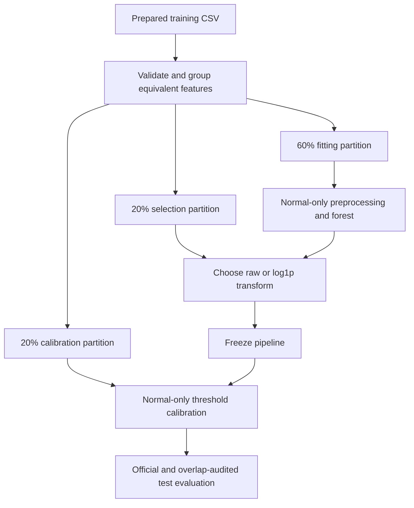

# Network Intrusion Detection Using AI

A local Fisk University Junior Seminar project using **Isolation Forest**, the prepared **UNSW-NB15** CSVs, and **Streamlit**. Learn normal traffic patterns, replay recorded flows safely, investigate unusual connections and evaluate the model against labeled attacks.

No paid APIs, cloud subscriptions, database, Docker, GPU, packet capture, or offensive traffic generation.

## Run on macOS

From Terminal in this folder, use Python 3.11+:

```bash
python3 -m venv .venv
./.venv/bin/python -m pip install -r requirements.txt
```

The six direct dependency versions are pinned to the versions used for this verified run. You do not need to activate the environment or modify Anaconda.

Download `UNSW_NB15_training-set.csv` and `UNSW_NB15_testing-set.csv` from the [official dataset page](https://research.unsw.edu.au/projects/unsw-nb15-dataset), using its **HERE** link and prepared training/testing folder. Extract ZIPs first. Place both files in `data/`, keeping the exact names. The original full, headerless CSV files are different inputs and are not supported.

```bash
./.venv/bin/python train_model.py
./.venv/bin/python -m streamlit run app.py
```

Open the localhost address printed by Streamlit. If it is already running, refresh the browser after training. Stop the server with Control-C. The supplied files were verified locally to contain 175,341 training rows, 82,332 test rows and 45 columns each. No dataset is bundled in Git.

Custom paths: `./.venv/bin/python train_model.py --train /path/train.csv --test /path/test.csv`. The dashboard’s default analysis/replay uses the standard testing filename under `data/`; CSV upload works without that file. Optional `--max-normal 10000` limits fitting records. `--false-alarm-budget .05` sets the calibration budget; choose it before looking at test results, not by optimizing on the test set.

## What makes the experiment defensible



**Input contract.** We select 23 numeric features and three categorical features (`proto`, `service`, `state`). See `utils.py` for the exact 26 inputs. IDs, `label`, `attack_cat`, and all other columns are excluded from the model. Original extra columns remain available in exported reports.

**Cleaning.** Numeric columns must contain nonnegative numbers or missing cells. Empty strings and infinities become missing; other malformed values produce an error. Categories are trimmed, lowercased and assigned an explicit unknown value when missing. Numeric medians are learned only from normal fitting rows. Entirely missing fitting features cause a clear training failure rather than silently disappearing.

**Feature grouping and duplicates.** Identical selected feature vectors are grouped using deterministic pandas hashes. We retain one representative per unambiguous training group and exclude groups whose labels conflict. This avoids splitting equivalent inputs across fitting, selection and calibration. It is not proof that the original flows are identical, and it is not a true session or chronological split. Different flows can collide in this selected feature representation; hash collisions are also theoretically possible.

**Splits.** Unique unambiguous training inputs are stratified 60/20/20 with seed 42. The forest and all learned preprocessing use normal fitting rows only (up to 50,000). A runtime assertion verifies no feature group crosses the three partitions. Attack records are never used to fit the forest.

**Two predefined candidates.** Compare raw numeric inputs with `log1p` compression. The latter reduces heavy skew in byte counts, rates and timings; unlike linear scaling, it changes the geometry seen by random splits. One-hot encoding groups categories seen fewer than 10 times into an infrequent bucket; unseen values use that bucket where one exists, otherwise an all-zero encoding. Training rows alone determine categories and imputation.

**Selection.** Each candidate uses 250 trees, 512 sampled rows per tree and seed 42. Its provisional cutoff is the 95th percentile of normal fitting scores. Choose the highest selection F1 among candidates with selection FPR ≤10%; if neither qualifies, choose the lowest selection FPR. These rules are fixed before test evaluation. Because selection uses attack labels, this is a **semi-supervised experiment**, even though the forest itself fits normal traffic only.

**Calibration.** After selection, use the independent normal calibration rows to set the 95th-percentile raw anomaly cutoff (`method='higher'`). Do not refit afterward. This sets an approximately 5% normal calibration alert rate, not a promised 5% test or production FPR. Calibration is finite-sample empirical calibration, not a probabilistic guarantee. The reported mixed calibration metrics are descriptive; its normal rows were used to set the cutoff.

**Testing.** Freeze the transform, forest and threshold before reading test labels. Report the full official split plus a separate subset of unique selected test inputs absent from the entire training CSV. This sensitivity analysis changes the population and attack mix, so it must not be compared as if it were the same test population. The original official results were already inspected before this upgrade, so this remains a development comparison rather than a pristine blind benchmark.

## Real results from the local run

These are computed results, not targets. The exact run metadata and source SHA-256 fingerprints are in `models/evaluation.json` after training.

| Population | Records | Accuracy | Precision | Recall | F1 | False-positive rate |
|---|---:|---:|---:|---:|---:|---:|
| Original pipeline · official test | 82,332 | 54.20% | 81.30% | 21.84% | 34.43% | 6.16% |
| Audited pipeline · official test | 82,332 | 74.00% | 83.39% | 65.92% | 73.63% | 16.09% |
| Unique test inputs absent from training | 49,438 | 67.42% | 59.56% | 20.49% | 30.49% | 7.45% |

Selected transform: `log1p`. Full-test ROC-AUC: **0.810**; average precision: **0.783**, versus attack prevalence **0.551** as the no-skill AP reference. The dashboard also includes a majority-class comparator determined from the deduplicated fitting pool. It is a trivial reference, not a second AI model.

The revised model detects 29,882 labeled attacks, misses 15,450 and flags 5,953 normal flows on the official test split. Its improved recall comes with more false alarms. The threshold produces 5.00% FPR on its normal calibration data but 16.09% on the full test data: **the calibration budget does not carry over to a shifted test distribution**.

Audit findings: **78,250 repeated selected-feature rows in training**, **30,982 in testing**, **14,197 test rows matching training-file inputs**. There were 393 ambiguous training groups containing 2,672 rows, excluded from development. After deduplication/conflict exclusion: 96,698 development rows, split into 58,018 fitting-pool rows, 19,340 selection rows and 19,340 calibration rows. The lower 20.49% attack recall on the stricter test subset is a central limitation, not a result to hide. Repeated benchmark patterns and population differences materially affect the headline metrics.

## Dashboard

| Page | What you can demonstrate |
|---|---|
| Dashboard Overview | Actual prediction counts, signed score distribution, protocol footprint, priorities, record explorer and exports |
| Live Traffic Simulation | Seeded, shuffled dataset replay with start/pause/reset, scenario choice, timestamped alerts and score timeline |
| AI Intrusion Detection | Schema validation, missing-value audit, unseen-category warning, inference, filtering and exports |
| Explainable AI | Compare selected flows with normal fitting means, medians and 5–95% ranges; signed deviations in log1p space |
| Model Performance | Official/strict metrics, worked arithmetic, supervised comparison, false-positive/false-negative explorer, ROC/PR curves and family recall |
| Data & Methodology | Processing workflow, full 26-feature dictionary, quality/overlap audit, split counts and fingerprints |

The main title remains **Network Intrusion Detection Using AI**. FLOW / LAB is only the small workspace navigation label.

### Scores and alerts

Raw anomaly score = `-pipeline.score_samples(flow)`; larger is more unusual. Displayed score = raw score minus the calibrated threshold. **Positive means anomalous**; zero or below means normal. Scores are not probabilities.

Priority bands use positive score excesses in the normal calibration tail: Low above zero; Medium at/above the median tail excess; High at/above the 90th percentile. A small-tail fallback uses .025 and .075. The exact thresholds are saved and visible under Model Performance. They are demonstration triage categories, not confirmed attack impact ratings.

Replay is a random sample without replacement, shuffled with seed 42, then processed sequentially in replay order. Ground-truth labels select normal/attack scenarios but never influence prediction. Replay timestamps indicate local processing time; there are no original packet timestamps or real-time claims. Reports can be exported after pausing.

### Investigation and reports

Statistical investigation uses normal fitting references only. Because flow measures are skewed, deviations are computed after log1p; raw units and normal medians are shown separately. Constant and missing features are omitted. These values are **not exact feature contributions, SHAP values, or causal explanations**. A highly unusual legitimate record can still trigger an alert.

CSV reports include IDs, predictions, scores, priorities and original columns. Text summaries use labels from the actual analyzed source when present, not metrics copied from an unrelated source. The saved evaluation JSON is separately downloadable. Uploaded labels must be valid 0/1 values.

## Explain it to your professor

**One-sentence overview:** “I built a local network anomaly research dashboard that learns normal traffic, flags unusual flows, and checks those predictions against labeled benchmark attacks.”

**Isolation Forest:** Randomly split features repeatedly. Unusual records often become isolated after fewer splits than common observations. Combining many trees reduces the influence of one random split. Learning normal behavior does not guarantee every attack will look unusual.

**Dataset:** UNSW-NB15 is a published 2015 laboratory benchmark combining normal activities with generated attack behaviors across nine attack families. It is real published experimental data; it is not a capture from Fisk's network or proof of production readiness. The prepared split’s label distinguishes normal (0) and attack (1).

**Implementation summary:** validate selected features; audit equivalent inputs; stratify training into three partitions; fit normal-only pipelines; compare raw/log transforms; calibrate a threshold using independent normal records; evaluate both test populations; expose evidence through six pages. Five Python files keep model logic, training, UI and tests readable.

**Three-minute demonstration:**

1. Overview: explain model-derived counts and the zero-score alert boundary.
2. Model Performance: show precision/recall and false alarms together; switch to unique test inputs absent from training and explain why the result is weaker.
3. Data & Methodology: show the duplicate/overlap audit and train-only preprocessing. Clarify the semi-supervised selection step.
4. Replay: select Mixed, start, pause and inspect an alert. State explicitly that no network packets are generated.
5. Explainable AI: inspect a flagged record; distinguish statistical deviation from exact model reasoning.
6. Upload the test CSV for inference and download a report; describe what future authorized data would be needed for live validation.

**Five likely questions:**

1. **Why Isolation Forest?** It is CPU-friendly and learns a normal baseline without needing attack examples for forest fitting. It is appropriate for demonstrating novelty detection, but rare normal traffic can be flagged too.
2. **Is your system fully unsupervised?** No. The forest fits normal rows, identified with labels, and validation attack labels select between two transforms. I describe the complete experiment as semi-supervised.
3. **How do you prevent leakage?** Exclude labels/IDs from inputs; fit medians and categories only on normal fitting rows; group equivalent inputs before splitting; calibrate separately; freeze everything before test evaluation. The official split still has selected-feature overlap, which I explicitly audit.
4. **Why does the test FPR exceed 5%?** Five percent is an empirical calibration target on normal calibration records. A different distribution need not produce the same score distribution or false-alarm rate. The test data also weights repeated patterns differently.
5. **Why show a lower second recall?** The strict subset removes repeated test inputs and those appearing in training. It tests a different, less familiar population and reveals that aggregate benchmark metrics can overstate performance on unfamiliar patterns.

**Limitations and future work:** dated lab data, feature equivalence rather than session grouping, ambiguous-record exclusions, fixed seed and split, no confidence intervals across independent sessions, no external dataset, no packet capture, statistical rather than causal explanations, hand-defined priority semantics, categorical encoding limitations. Future work: a genuinely untouched recent dataset, authorized flow collection, session/time splits, multiple seeds, independent threshold validation and broader supervised comparisons. Do not tune thresholds on the test file to inflate headline results.

## Test and troubleshooting

```bash
./.venv/bin/python -m unittest -v test_project.py
```

Tests use your actual local data/model and cover label exclusion, no inference-time refitting, invalid inputs, model persistence, metrics reproduction, six page executions, replay controls, independent metric arithmetic, error classification and supervised-reference reproduction. See `VERIFICATION.md` for scope and limitations.

- Missing data: check `ls data`; extract ZIPs and keep exact filenames.
- Missing model: run training; the dashboard shows setup instructions until a model exists.
- Documents permission error: enable **Terminal → Documents Folder** under macOS Privacy & Security, then restart Terminal.
- Avoid Anaconda/pip mismatches: use `./.venv/bin/python -m pip` and `./.venv/bin/python -m streamlit`.
- Import/binary errors: create a fresh virtual environment with Python 3.11+ and reinstall requirements.
- Different model versions: retrain using the environment serving the app. Only load trusted local joblib artifacts.
- CSV errors: supply all required features; invalid numeric values/labels produce visible errors.
- Previously unseen categories: supported, with an upload warning; predictions on unfamiliar distributions require caution.
- Changed test file: dashboard warns when its SHA-256 differs from the saved evaluation file. Traffic charts use the current file; saved performance refers to the original run.
- Changed model: uploaded predictions and replay state are cleared automatically to prevent mixing versions.

## Project files and GitHub

- `app.py`: six dashboard pages and replay.
- `ui.py`: shared styling and charts.
- `utils.py`: feature contract, validation, scoring, evaluation, investigation.
- `train_model.py`: audited training/calibration/evaluation and saved artifacts.
- `test_project.py`: meaningful pipeline and dashboard checks.
- `requirements.txt`: tested direct dependency versions.

The original model is preserved locally as `models/original_isolation_forest.joblib`. Data, models, evaluation JSON and the virtual environment are ignored by Git. Nothing is pushed automatically.

```bash
git add .
git commit -m "Build audited network anomaly detection dashboard"
git branch -M main
git remote add origin https://github.com/YOUR_USERNAME/YOUR_REPOSITORY.git
git push -u origin main
```

Check dataset terms before redistributing data. The README includes computed results for your seminar; retraining regenerates model binaries and the evaluation record.

## Academic attribution

- [UNSW-NB15 official dataset](https://research.unsw.edu.au/projects/unsw-nb15-dataset).
- Moustafa, N. and Slay, J. (2015). *UNSW-NB15: a comprehensive data set for network intrusion detection systems (UNSW-NB15 network data set).* MilCIS, IEEE.
- Moustafa, N. and Slay, J. (2016). *The evaluation of Network Anomaly Detection Systems: Statistical analysis of the UNSW-NB15 dataset and the comparison with the KDD99 dataset.* Information Security Journal.
- [scikit-learn Isolation Forest](https://scikit-learn.org/stable/modules/generated/sklearn.ensemble.IsolationForest.html).


## Technical extension: supervised reference and metric evidence

The main detector remains Isolation Forest. A **Logistic Regression reference** now fits normal AND attack labels from the same 58,018-row fitting pool. Its separate numeric pipeline uses median imputation, log1p and StandardScaler. One-hot encoding handles categories. All learned preprocessing fits its fitting pool only. Settings are fixed: C=1, lbfgs, max_iter=1000, seed=42. Its threshold is the 95th percentile of positive-class scores on the same independent normal calibration records used for the IF alarm-budget policy. Neither threshold uses test labels. This is a stronger-supervision comparison, not a controlled isolation of algorithm choice.

| Official test, 82,332 rows | Accuracy | Precision | Recall | F1 | FPR | ROC-AUC | Average precision |
|---|---:|---:|---:|---:|---:|---:|---:|
| Isolation Forest | 74.00% | 83.39% | 65.92% | 73.63% | 16.09% | .8100 | .7826 |
| Logistic Regression reference | 86.21% | 87.10% | 87.99% | 87.54% | 15.97% | .9536 | .9652 |

On the 49,438 unique test inputs absent from training, the reference has 72.41% recall, 73.27% F1 and 13.52% FPR. IF retains 20.49% recall, 30.49% F1 and 7.45% FPR. The reference catches more attacks while also flagging more normal records on this stricter population. These remain development results on the same benchmark, not blind external validation. The new supervised model converged in 207 iterations in the verified run. The saved artifact is models/logistic_regression.joblib and contains both its pipeline and threshold.

**Worked metric calculations:** Model Performance exposes exact TP/FP/FN/TN substitutions. Positive means an attack label or an anomalous prediction. Accuracy=(TP+TN)/N, precision=TP/(TP+FP), recall=TP/(TP+FN), F1=2TP/(2TP+FP+FN), FPR=FP/(FP+TN). Counts and scores feed sklearn.metrics. ROC-AUC and average precision use continuous scores rather than the binary decisions. Undefined denominators display N/A in the worked-arithmetic table; sklearn precision/recall/F1 use zero_division=0 in saved reports.

**Error explorer:** View actual false positives and false negatives and download all evaluation errors. It requires valid ground-truth labels. A feature dictionary explains all selected inputs; it does not claim the feature subset is optimal.

Nine automated tests now pass. The original IF predictions and metrics remain unchanged. Restart the Streamlit process once after updating imported Python modules if the running server retains an earlier module version.
# Junior-Seminar
